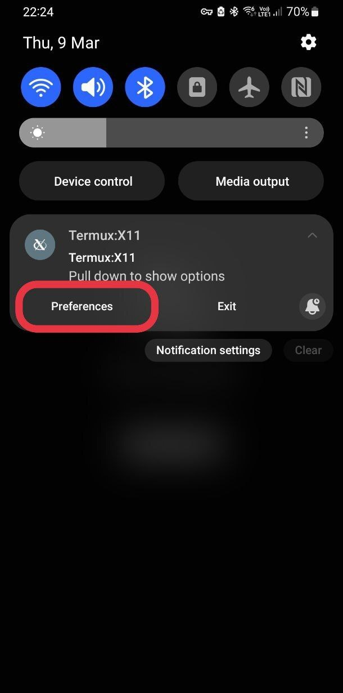
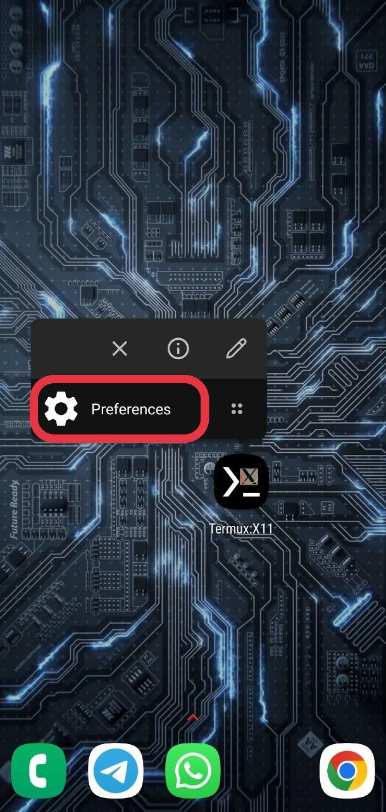
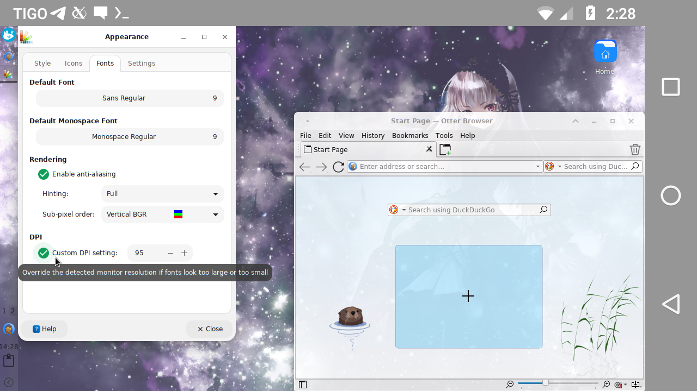

# Termux:Wayland

[](https://github.com/HomuHomu833/termux-wayland/actions/workflows/debug_build.yml)

A [Termux](https://termux.com) Wayland compositor add-on app, forked from [Termux:X11](https://github.com/termux/termux-x11).

## About
Termux:Wayland is a Wayland compositor. It is built with Android NDK and optimized to be used with Termux.
It is Termux:X11 with the X server replaced by a Wayland compositor: the app, its preferences, extra keys
bar and touch modes are the same. X11 programs run through Xwayland.

This is a work in progress: it has been tested with real clients on Linux, not yet on a phone.

## Submodules caveat
This repo uses submodules. Use 

```
git clone --recurse-submodules https://github.com/HomuHomu833/termux-wayland 
```
or
```
git clone https://github.com/HomuHomu833/termux-wayland
cd termux-wayland
git submodule update --init --recursive
```

## How does it work?
Just like any other Wayland compositor.

`termux-wayland` runs the compositor in a Termux process, like `termux-x11` runs the X server. It draws all
windows with OpenGL ES into an AHardwareBuffer once per display refresh, and the app shows that buffer and
sends input back. Clients can draw with the CPU (llvmpipe, lavapipe: `wl_shm`) or, where `/dev/dri/renderD128`
is accessible, with a Mesa GPU driver (`linux-dmabuf`).

Supported protocols: `wl_compositor`, `wl_subcompositor`, `wl_shm`, `wl_output`, `wl_seat`, `wl_data_device_manager`,
`xdg_wm_base`, `zxdg_decoration_manager_v1`, `zxdg_output_manager_v1`, `wp_viewporter`, `zwp_linux_dmabuf_v1`,
`zwp_text_input_v3`, `zwp_relative_pointer_v1`, `zwp_pointer_constraints_v1`.

Windows fill the screen, dialogs float centered over their window, the focused window is on top.
Use Alt+Tab to switch windows, Alt+F4 to close one. For a desktop with movable windows, run a desktop
compositor (labwc, sway, weston...) as a Wayland client, or an X11 desktop through Xwayland.

## Setup Instructions
Termux:Wayland requires Android 8 or later. It consists of an Android app and a companion termux package, and you must install both.

The Android app and the companion package are available from the artifacts of the [last successful build](https://github.com/HomuHomu833/termux-wayland/actions/workflows/debug_build.yml) of this repository. Download and install `termux-wayland-universal-debug.apk`, then install the companion package with `dpkg -i termux-wayland-nightly-*-all.deb`.

For X11 programs you also need Xwayland: `pkg i x11-repo && pkg i xwayland`.

### Avoiding slowdowns
<details>
<summary>Android gives less CPU time to apps that aren't on screen — install the sharedUid APK to avoid this</summary>

Android gives less CPU time to apps that aren't on screen. Once Termux:Wayland opens, Android treats Termux itself as no longer being on screen, so things running inside Termux (like your desktop apps) can slow down.

To avoid this, install `termux-wayland-universal-sharedUid-debug.apk` instead of the regular one (same CI artifacts). This variant runs as part of Termux itself, so Android keeps treating it as one app and doesn't slow it down.

This variant only works with the Termux app installed **from GitHub**, not F-Droid or Google Play — those are signed with different keys, and a shared UID requires matching signatures.
</details>

## Running Graphical Applications
You can start your desired graphical application by doing:
```
termux-wayland -xstartup "foot"
```
or
```
termux-wayland -- foot
```
or
```
termux-wayland &
env XDG_RUNTIME_DIR=$TMPDIR WAYLAND_DISPLAY=wayland-0 foot
```

The socket is `$XDG_RUNTIME_DIR/wayland-0` (the first free `wayland-N`, or the name given with `-socket`).
If `XDG_RUNTIME_DIR` is not set, `$TMPDIR` is used.

Also you can do 
```
export TERMUX_WAYLAND_XSTARTUP="foot"
termux-wayland
```

If you're done using Termux:Wayland just simply exit it through its notification drawer by expanding the Termux:Wayland notification then "Exit"
But you should pay attention that `termux-wayland` command is still running and can not be killed this way.

### Running X11 applications
X11 programs run in Xwayland. `termux-wayland-x11` takes the same arguments as `termux-x11` and starts Termux:Wayland with a fullscreen Xwayland on the display:
```
termux-wayland-x11 :1 -xstartup "dbus-launch --exit-with-session xfce4-session"
```
or
```
termux-wayland-x11 :1 -- dbus-launch --exit-with-session xfce4-session
```
or
```
termux-wayland-x11 :1 &
env DISPLAY=:1 dbus-launch --exit-with-session xfce4-session
```
`TERMUX_X11_XSTARTUP` works too. X server options (`-ac`, `-dpi`, `-listen tcp`...) go to Xwayland; Termux:X11's `-legacy-drawing`, `-force-bgra`, `-disable-dri3` and `-force-sysvshm` are accepted and ignored.

If you do not use Termux:X11, you can make scripts written for it use Termux:Wayland:
```
ln -sf $PREFIX/bin/termux-wayland-x11 $PREFIX/bin/termux-x11
```
(It is not installed as `termux-x11` so that both apps can be installed at the same time.)

### Options
```
termux-wayland [options] [-- command args...]
  -scale N          output scale (default: the app's preference, else from the screen density)
  -socket NAME      Wayland socket in $XDG_RUNTIME_DIR (default: first free wayland-N)
  -keymap FILE      XKB keymap for clients (xkbcli compile-keymap --layout ...); default us
  -no-dmabuf        no linux-dmabuf: GPU clients fall back to wl_shm
  -no-dmabuf-import copy dma-bufs instead of importing them into EGL
  -no-ahb           upload textures with glTexSubImage2D instead of AHardwareBuffers
  -xstartup "cmd"   run cmd with WAYLAND_DISPLAY set; the server exits with it
  -- command args   same, without a shell
```

## Using with proot environment
If you plan to use the program with proot, keep in mind that you need to launch proot/proot-distro with the --shared-tmp option. 

If passing this option is not possible, set the TMPDIR environment variable to point to the directory that corresponds to /tmp in the target container.

Example, run in a Termux shell (not inside the proot container):
```
termux-wayland &
proot-distro login ubuntu --shared-tmp
```
Then, inside the container:
```
export XDG_RUNTIME_DIR=/tmp WAYLAND_DISPLAY=wayland-0
dbus-launch --exit-with-session labwc
```

## Using with chroot environment
If you plan to use the program with chroot or unshare, you must run it as root and set the TMPDIR environment variable to point to the directory that corresponds to /tmp in the target container.

This directory must be accessible from the shell from which you launch termux-wayland, i.e. it must be in the same SELinux context, same mount namespace, and so on.

You can get loader for nightly build from an artifact of [last successful build](https://github.com/HomuHomu833/termux-wayland/actions/workflows/debug_build.yml)

Do not forget to disable SELinux
```
setenforce 0
export TMPDIR=/path/to/chroot/container/tmp
export CLASSPATH=$(/system/bin/pm path com.termux.wayland | cut -d: -f2)
/system/bin/app_process / --nice-name=termux-wayland com.termux.wayland.CmdEntryPoint
```

### Force stopping the compositor (running in termux background, not an activity)

termux-wayland's compositor runs in process with name "termux-wayland". You can kill it by
```
pkill -f termux-wayland
```

### Closing Android activity (running in foreground, not the compositor)

```
am broadcast -a com.termux.wayland.ACTION_STOP -p com.termux.wayland
```

### Opening Termux:Wayland activity from command line

```
am start --user 0 -n com.termux.wayland/com.termux.wayland.MainActivity
```

### Logs
If you need to obtain logs from the `com.termux.wayland` application,
set the `TERMUX_WAYLAND_DEBUG` environment variable to 1, like this:
`TERMUX_WAYLAND_DEBUG=1 termux-wayland`

The log obtained in this way can be quite long.
It's better to redirect the output of the command to a file right away.

### Notification
In Android 13, posting notifications was restricted so you should explicitly let Termux:Wayland show you notifications.

Preferences:
You can access preferences menu three ways:
<details>
<summary>By clicking "PREFERENCES" button on main screen when no client connected.</summary>


</details>
<details>
<summary>By clicking "Preferences" button in notification, if available.</summary>


</details>
<details>
<summary>By clicking "Preferences" application shortcut (long tap `Termux:Wayland` icon in launcher). </summary>


</details>

(The screenshots are Termux:X11's; the menus are the same.)

## Toggling keyboard
Just press "Back" button.

The keyboard also shows up by itself when a text field is focused in apps that support it (GTK, Qt, SDL, foot...); turn this off with "Show the keyboard when a text field is focused" in the keyboard preferences.

## Touch gestures
### Touchpad emulation mode.
In touchpad emulation mode you can use the following gestures:
* Tap for click
* Double tap for double click
* Two-finger tap for right click
* Three-finger tap for middle click
* Two-finger vertical swipe for vertical scroll
* Two-finger horizontal swipe for horizontal scroll
* Three-finger swipe down to show-hide additional keys bar.
### Simulated touchscreen mode.
In simulated touchscreen mode you can use the following gestures:
* Single tap for left button click.
* Long tap for mouse holding.
* Double tap for double click
* Two-finger tap for right click
* Three-finger tap for middle click
* Two-finger vertical swipe for vertical scroll
* Two-finger horizontal swipe for horizontal scroll
* Three-finger swipe down to show-hide additional keys bar.
### Direct touch mode.
Touches go to apps as Wayland touch events, so touch-aware apps (GTK, Qt, SDL...) can use their own gestures.

When a game locks the pointer, Termux:Wayland captures the mouse for it ("Capture the pointer when a game locks it" in the pointer preferences).

## Font or scaling is too small!
Wayland apps scale by themselves: set "Wayland output scale" in the output preferences (`auto` picks it from your screen density), or start `termux-wayland` with `-scale`.
```
termux-wayland -scale 2 -- foot
```

For X11 apps in Xwayland, set the DPI in your desktop settings (in the case of xfce4 and lxqt via Applications Menu > Settings > Appearance) or pass `-dpi` to Xwayland.
<details>
<summary> Screenshot </summary>

 
</details>

```
termux-wayland-x11 :1 -xstartup "xfce4-session" -dpi 120
```

## Changing, dumping and restoring preferences from commandline

It is possible to change preferences of termux-wayland from command line.
`termux-wayland-nightly` package contains `termux-wayland-preference` tool which can be used like 
```shell
termux-wayland-preference [list] {key:value} [{key2:value2}]...
```

Use `termux-wayland-preference list` to dump current preferences.
Use `termux-wayland-preference list > file` to dump current preferences to file.
Use `termux-wayland-preference < file` to restore preferences from file.
Use `termux-wayland-preference "fullscreen"="false" "showAdditionalKbd"="true"` to disable fullscreen and enable additional key bar. The full list of preferences you can modify is available with `termux-wayland-preference list` command. You can specify one or more preferences here.

Termux:Wayland activity should be available in background or foreground, otherwise `termux-wayland-preference` tool will hang indefinitely.
In the case if there is `Store preferences for secondary displays separately` preference active `termux-wayland-preference` will use/modify preferences of display where Termux:Wayland activity is currently opened.

## Using with 3rd party apps
It is possible to use Termux:Wayland with 3rd party apps.
Check how `shell-loader/src/main/java/com/termux/wayland/Loader.java` works.

## Testing without a phone
`host/` builds the compositor for Linux: it draws off screen, saves each frame as an image and takes the app's input events from a socket, so it can be tried with real clients.
```
cmake -S host -B build-host -G Ninja && ninja -C build-host
build-host/twl-headless --socket wl-test --size 1280x720 --scale 2 --dump /tmp/frame.ppm --events /tmp/twl-ev &
WAYLAND_DISPLAY=wl-test gtk3-widget-factory
```

# License
Released under the [GPLv3 license](https://www.gnu.org/licenses/gpl-3.0.html), like Termux:X11. libwayland and libffi are MIT.
